### Overview

This guide will walk you through setting up your Cyton, connecting it to your computer, and then connecting it to yourself to measure ExG signals (such as EEG, EMG, ECG, or EOG). Please review this guide in its entirety before starting, and consult the [Cyton Biosensing Tutorial Video](https://youtu.be/D5RCu41msT4) for extra guidance. Have fun!

## What You Need

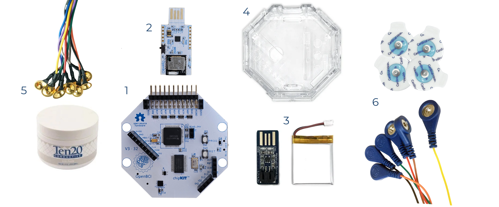

1.  **OpenBCI [Cyton Board](https://shop.openbci.com/collections/frontpage/products/cyton-biosensing-board-8-channel)**

    The Cyton is OpenBCI's 8-channel amplifier, a biosensing board you can use to measure EEG, EMG, or ECG signals with electrodes. You can expand it to 16 channels with the [Daisy Module](011-Daisy_Getting_Started_Guide.md). For full specs (power input, switches, pinout, schematics), see the [OpenBCI Cyton Hardware Doc](../../Cyton/02-Cyton.md).

    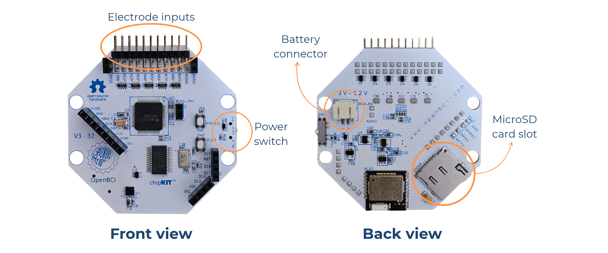

2.  **OpenBCI USB Dongle**

    The Cyton sends its data by radio to this USB dongle, which plugs into your computer. For specs and details, see the [OpenBCI USB Dongle](../../Cyton/02-Cyton.md#openbci-usb-dongle) section of the hardware doc.

3.  **Lithium battery and USB charger**

    We recommend using the 3.7V LiPo battery and USB charger that come with your kit.

4.  **Board Case**

    Use the clear case that comes with your board to protect it.

5.  **EEG electrodes:** OpenBCI Gold Cup Electrodes and [Ten20 Paste](https://shop.openbci.com/products/ten20-conductive-paste-8oz-jar)

    If you ordered OpenBCI Gold Cup Electrodes and Ten20 Paste, you should have:

    -   10 passive, gold cup electrodes on a color-coded ribbon cable
    -   A jar of Ten20 conductive electrode paste

    If you plan to work with your own cap or electrodes, the [Touch-Proof Adapter](https://shop.openbci.com/products/touch-proof-electrode-cable-adapter) will come in handy: it converts any touch-proof style electrode into one that can be plugged into an OpenBCI board.

6.  **Or EMG/ECG electrodes:** disposable [solid gel snap electrodes](https://shop.openbci.com/products/kendall-emg-ecg-foam-solid-gel-electrodes-50-pack) that snap onto [Snap Electrode Cables](https://shop.openbci.com/collections/frontpage/products/snap-electrode-cables-emg-ecg-eeg?variant=32372786958), which can be plugged directly into the Cyton's pin headers.

7.  **A computer with the OpenBCI GUI installed and with an available USB port for the dongle.**

    Don't have the GUI installed yet? [Follow the step-by-step guide](../../Software/OpenBCISoftware/01-OpenBCI_GUI.md) to install the OpenBCI_GUI as a standalone application before continuing. Keep an eye out for specific Cyton requirements, such as installing the FTDI VCP driver.

## Setting Up Your Hardware

1.  **Charge your battery**

    Fully charge the Lithium Polymer (LiPo) Battery, until the charger's indicator LED turns green. To do this, insert the battery's white plug into the matching slot on the USB charger, and connect the charger into a USB port. We recommend charging it for several hours, ideally overnight, before your first use.

2.  **Place the battery and the case**

    Plug the charged battery into the 2-pin JST battery connector on the back of your Cyton board (see the back view above).

    :::caution
    Cyton boards have specific input voltage ranges, printed on the back of the board next to the battery connector. Do not supply your board with voltages above this range, or you will damage your board's power supply. For this reason, we recommend that you always use the battery that came with your OpenBCI kit.
    :::

    **Important note:** If you are using a non-OpenBCI battery holder (not recommended), please check the polarity (red +/black -) BEFORE powering up your OpenBCI board. A reversed polarity will burn out your board.

    Place the board and battery into the clear case.

3.  **Attach your electrodes**

    For EEG electrodes, plug each electrode's connector onto the board's pins with the small silver latch facing up. The connectors are slightly wider on the silver side, so turning them all the same way lets them fit side by side.

    For EMG/ECG electrodes, plug the snap cables directly into the Cyton's pin headers, then snap the foam electrodes onto the other end of each cable.

    See the [**Connect yourself to OpenBCI**](#connect-yourself-to-openbci) section below for guides on where to place electrodes on the body and how to set up your reference electrodes for different biosensing setups.

4.  **Plug in the USB Dongle**

    Plug the OpenBCI USB Dongle into your computer (facing upwards!). You should see a very brief red LED blink, and then the blue LED (labeled gpio2 on the dongle) lights up and stays on.

    **Note:** make sure your USB Dongle is switched to GPIO_6 and not RESET. The switch should be set closer to your computer, as shown on the back of the dongle in the picture below.

    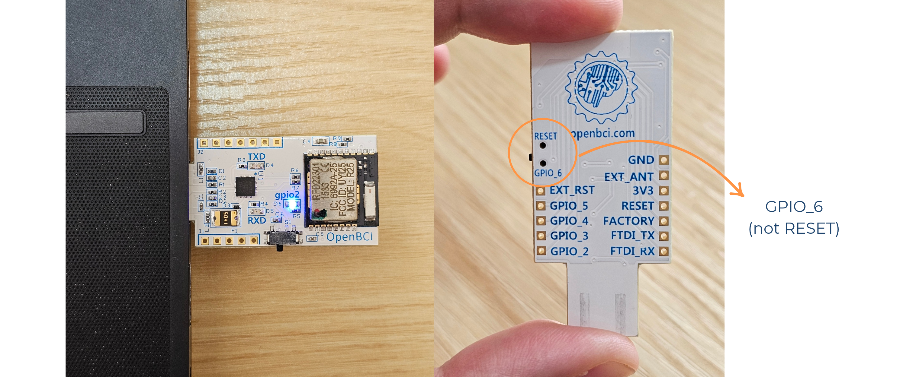

    :::caution Using Windows? Change the FTDI latency
    The default FTDI latency is too large for EEG applications, making the incoming signal "choppy" and seem as if it's accumulating packets for about a full second before releasing them all at the same time into the serial stream. Now that the Dongle is plugged in, its COM port shows up on your computer, so you can change this setting. Follow the [Latency Settings Fix](../../Troubleshooting/04-FTDI_Fix_Windows.md#ii-latency-settings-fix) in the FTDI Driver Fix Guide for Windows.
    :::

5.  **Power on your Cyton**

    Move the small switch on the side of the board from "OFF" to "PC" (not BLE). As soon as you do, you should see a blue LED turn on. If it doesn't, make sure your battery is fully charged. If it is, consult the [hardware section](https://openbci.com/forum/index.php?p=/categories/cyton) of our Forum.

    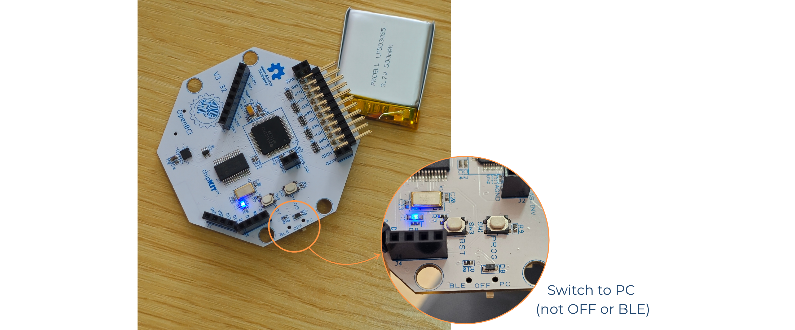

    **Note:** it's important to plug in your Dongle before you turn on your Cyton board. Sometimes, if the data stream seems broken, you may need to unplug your USB Dongle and power down your Cyton board. Make sure to plug your USB Dongle in first, then power up your board afterwards.

## Start Using The OpenBCI GUI

Open the OpenBCI GUI now that your hardware is set up.

### Connect the GUI to your Cyton board

**Select `CYTON (live)` from the `DATA SOURCE` list.**

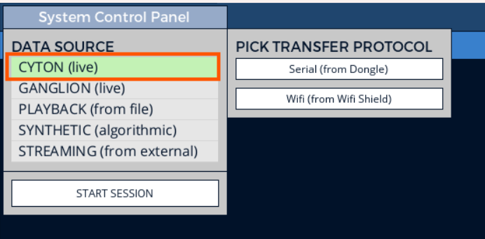

**Select `Serial (from Dongle)` as the transfer protocol.**

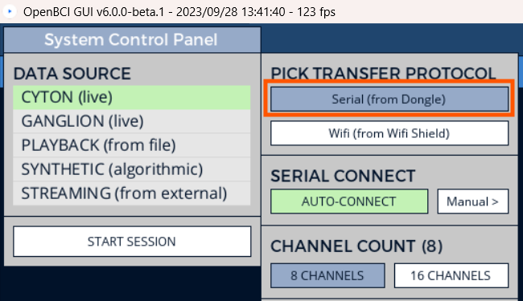

**Select your channel count (8 or 16).** Under `CHANNEL COUNT`, the setting defaults to `8 CHANNELS`. If you are using a Cyton board with a Daisy Module (16 channels), click `16 CHANNELS`. Do this before connecting, because `AUTO-CONNECT` starts the session right away.

Like the channel count, the optional settings below need to be chosen before you connect.

Optional settings: want to change where your data is saved, record to an SD card, or use more than one Cyton? Open this section.
 

- **Session name and file format:** in the `SESSION DATA` panel you can rename the session folder and choose the file format. See [Access Recorded Data](../../Software/OpenBCISoftware/01-OpenBCI_GUI.md#access-recorded-data) in the OpenBCI GUI guide.
- **Record to a MicroSD card:** the `WRITE TO SD CARD?` panel lets you log data to a MicroSD card inserted in the Cyton. See [Writing to SD Card using the OpenBCI GUI](../../Cyton/09-Using_SD_Card_with_OpenBCI.md#writing-to-sd-card-using-the-openbci-gui).
- **Use more than one Cyton in the same room:** each Cyton and its Dongle need their own radio channel. See [How to Run Multiple Cytons Simultaneously](../../Cyton/Change_Cyton_Radio_Channel.md).

**Click `AUTO-CONNECT`, under `SERIAL CONNECT`.**

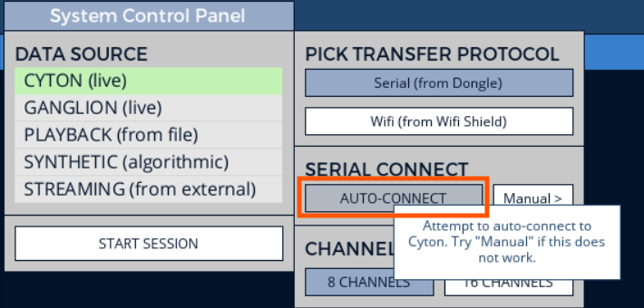

The GUI looks for your Dongle, connects to your Cyton, and starts the session. If the Dongle and the Cyton are not on the same radio channel, the GUI scans the channels automatically first. This can take a few seconds.

AUTO-CONNECT didn't work? Connect manually
 

1.  **Open the manual settings.** Under `SERIAL CONNECT`, click `Manual >`. This opens the `SERIAL/COM PORT` and `RADIO CONFIGURATION` panels.

    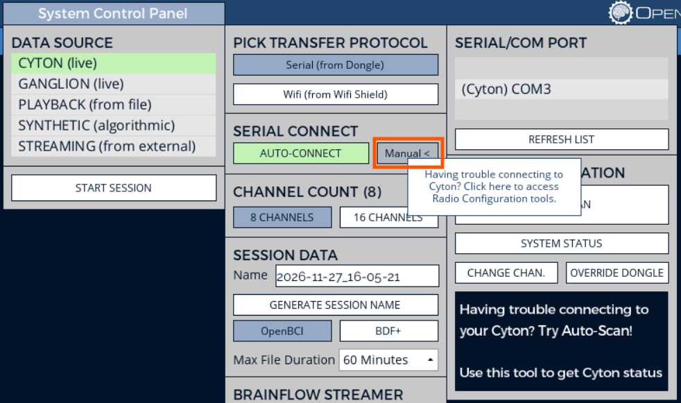

2.  **Select your Dongle's port.** In the `SERIAL/COM PORT` list, click your Dongle's port so it turns green. It is listed as `(Cyton) COM#` on Windows, or `(Cyton) /dev/...` on macOS and Linux.

    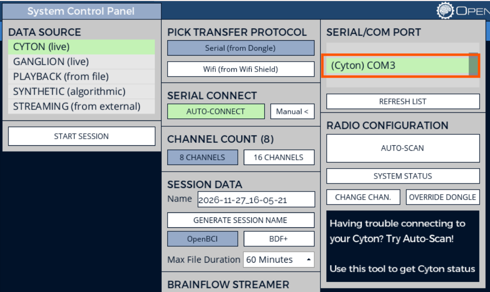

3.  **Don't see your Dongle?** Make sure it is plugged in and its switch is set to GPIO_6, then click `REFRESH LIST`.

    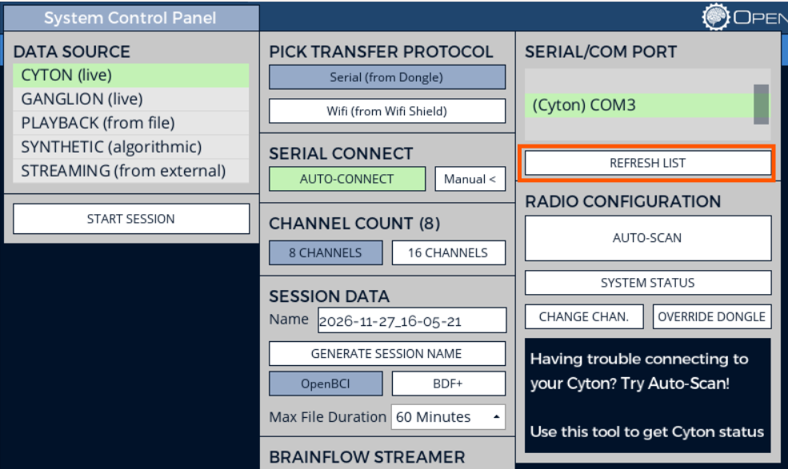

4.  **Click `START SESSION`.** In manual mode the session doesn't start on its own, so you need to click this button.

    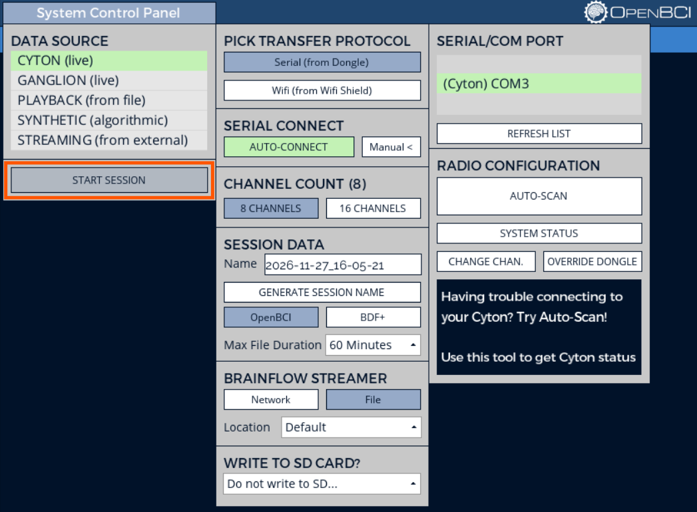

5.  **Still not connecting?** Under `RADIO CONFIGURATION`, click `AUTO-SCAN`. The GUI scans the radio channels until the Dongle finds your Cyton. Then click `START SESSION` again.

For more help, see the [GUI Troubleshooting](../../Troubleshooting/02-GUI_Troubleshooting.md#cyton-gui-manual-connection-steps) guide.

If you're having trouble connecting to your Cyton, see the [Troubleshooting Connection Issues](#troubleshooting-connection-issues) section below.

### Navigating the GUI

When the GUI connects, the message `Session started!` appears at the bottom of the window and the GUI opens the default layout, shown below.

For a more in-depth guide to the GUI interface and functionality, and the different built-in widgets, check out the [OpenBCI GUI Widget Guide](../../Software/OpenBCISoftware/02_GUI_Widget_Guide.md). Refer to the [Cyton Data Format Guide](../../Cyton/03-Cyton_Data_Format.md#binary-format) to learn how to interpret the raw data directly from the device. However, this is already handled gracefully by [BrainFlow](../../ForDevelopers/01-SoftwareDevelopment.md#introducing-brainflow) for a number of programming languages and use cases.

**Click `Start Data Stream`, in the top-left corner, to stream data from your Cyton board.**

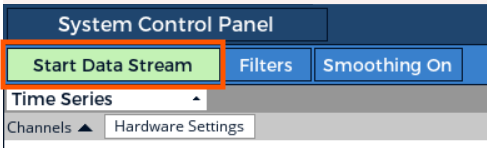

On the USB Dongle, the red LED labeled TXD lights up while data is streaming.

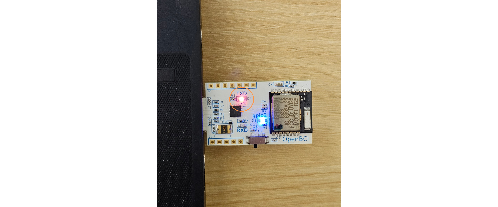

You should also see data streaming into the GUI:

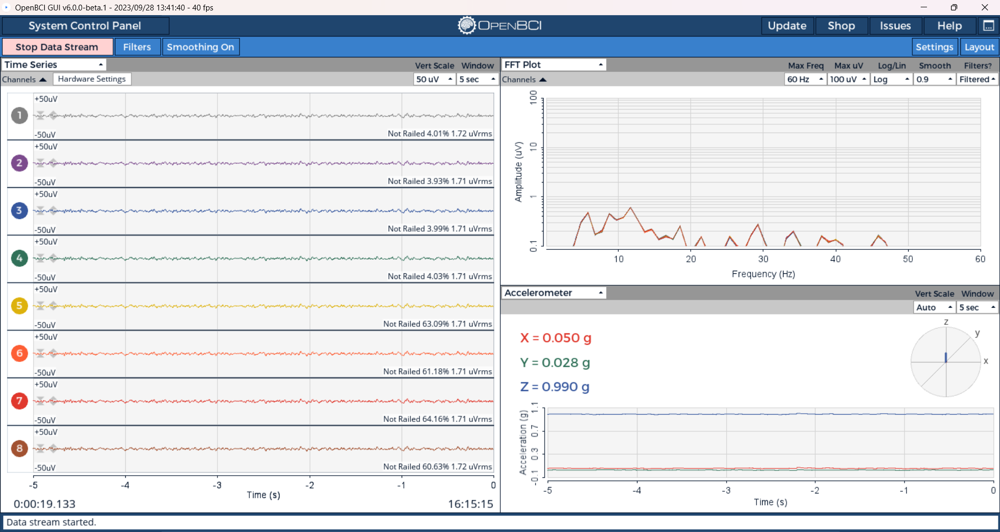

Try running your fingers along the electrode pins at the top of your board. You should see the 8 (or 16 if you're using a Daisy module) channels on the _Time Series_ widget behave chaotically in response to you touching the pins, and all the traces of the FFT graph on the upper right should instantly shift upwards.

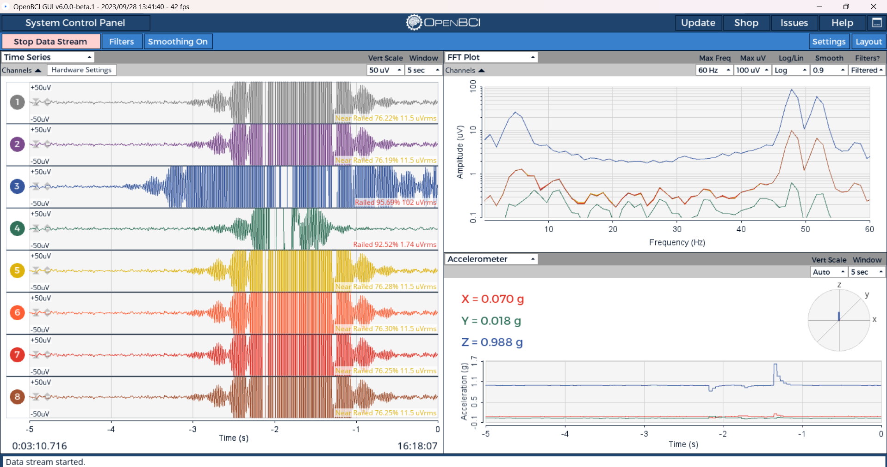

If this is the case, congratulations! You are now connected to your Cyton board.

:::info Where do I find my data?
If you want to look at your recorded data, keep in mind that by default the GUI saves each session in `[USER]/Documents/OpenBCI_GUI/Recordings`, in a folder named with an autogenerated timestamp. You can change the session name and location before connecting, in the optional settings above. To replay a recording, open the GUI and select `PLAYBACK (from file)` as the data source instead of `CYTON (live)`.
:::

Now that you've got your computer connected to the Cyton, it's time to connect yourself!

## Connect yourself to OpenBCI

To learn how to connect yourself to OpenBCI using your newly set up board, see the following tutorials:

-   [EEG Setup](../../GettingStarted/Biosensing-Setups/01-EEG-Setup.md)
-   [EMG Setup](../../GettingStarted/Biosensing-Setups/02-EMG-Setup.md)
-   [ECG Setup](../../GettingStarted/Biosensing-Setups/03-ECG-Setup.md)
-   [Multiple ExG Signals Setup](../../GettingStarted/Biosensing-Setups/04-ExG-Setup.md)

In the above setups, you may need to adjust the Hardware Settings of the ADS1299 chip, the core piece of technology in the Cyton. [Click here](../../Software/OpenBCISoftware/02_GUI_Widget_Guide.md#hardware-settings) for more info on Cyton Hardware Settings UI in the Time Series Widget. If you are an advanced user, you can look at the GUI console log after changing hardware settings and the [Cyton SDK Guide](../../Cyton/04-OpenBCI_Cyton_SDK.md) to learn how to send custom commands to the Cyton using [any BrainFlow binding](../../ForDevelopers/01-SoftwareDevelopment.md).

## Troubleshooting Connection Issues

If you're having connection issues, try the following steps in order:

1.  Power down your Cyton board and unplug your USB Dongle. Then plug your USB Dongle back in and power up your Cyton board, in that order. Then try connecting again.
2.  If this does not work, relaunch the OpenBCI GUI application, set up the System Control Panel again, and retry.
3.  Make sure that your battery is fully charged and then retry the steps above.
4.  If you are still having trouble connecting to your Cyton board, refer to the [Forum](https://openbci.com/forum/index.php?p=/categories/cyton) for extra troubleshooting advice.

If the data coming from your Cyton looks choppy, the FTDI driver settings may need adjusting:

-   **macOS:** on some Macs, the FTDI virtual COM port (VCP) driver's default settings make the data choppy. Newer Macs (mid-2015 and later) may not have this issue. See the [FTDI Driver Fix Guide for macOS](../../Troubleshooting/05-FTDI_Driver_Fix_Mac.md).
-   **Linux:** see the [FTDI Driver Fix for Linux](../../Troubleshooting/03-FTDI_Fix_Linux.md).
-   **Windows:** see the [Latency Settings Fix](../../Troubleshooting/04-FTDI_Fix_Windows.md#ii-latency-settings-fix) in the FTDI Driver Fix Guide for Windows.
